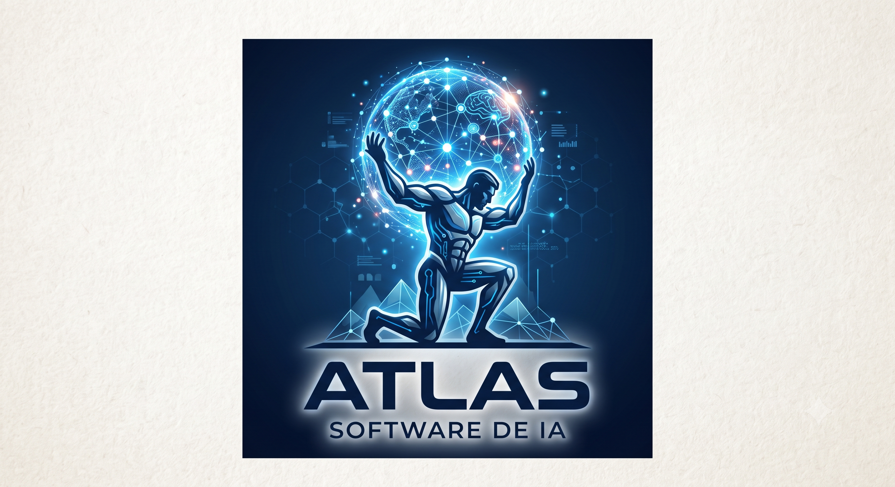

<p align="center">
  
</p>

<h1 align="center">Atlas AI</h1>

<p align="center">
  <a href="https://github.com/nousresearch/hermes-agent"></a>
  
  
</p>

**Atlas AI — el agente de IA auto-mejorable de GT Labs.** Crea skills a partir de la experiencia, las mejora durante el uso, persiste conocimiento por su cuenta, busca en sus propias conversaciones pasadas y construye un modelo de quién sos a través de las sesiones. Corre en un VPS de $5, un cluster de GPU o infraestructura serverless. No está atado a tu laptop — le hablás desde Telegram, Discord, Slack, WhatsApp o Signal mientras trabaja en una VM.

Usás el modelo que quieras — OpenRouter, OpenAI, tu propio endpoint y muchos otros. Cambiás con `atlas model` — sin tocar código, sin lock-in.

| | |
|---|---|
| **Interfaz de terminal real** | TUI completa: edición multilínea, autocompletado de slash-commands, historial, interrumpir-y-redirigir, salida de tools en streaming. |
| **Vive donde vos** | Telegram, Discord, Slack, WhatsApp, Signal y CLI — todo desde un solo gateway. Transcripción de audios, continuidad entre plataformas. |
| **Loop de aprendizaje cerrado** | Memoria curada por el agente con nudges periódicos. Creación autónoma de skills tras tareas complejas. Skills que se auto-mejoran. Búsqueda FTS5 en sesiones para recall entre conversaciones. |
| **Automatizaciones programadas** | Cron integrado con entrega a cualquier plataforma. Reportes diarios, backups nocturnos, auditorías semanales — en lenguaje natural, sin supervisión. |
| **Delega y paraleliza** | Subagentes aislados para workstreams en paralelo. Scripts Python que llaman tools por RPC. |
| **Corre donde sea** | Backends de terminal: local, Docker, SSH, Singularity, Modal, Daytona. |

---

## Instalación (desde código)

Atlas AI se instala **desde el repo** (es un fork, no tiene instalador hosteado). El gestor de paquetes es [uv](https://docs.astral.sh/uv/), que se encarga de Python y las dependencias.

**Requisitos:** Git y Python 3.11–3.13. El resto (Node.js, ripgrep, ffmpeg) lo bootstrapea `atlas postinstall`.

### Linux / macOS

```bash
# 1. uv (si no lo tenés)
curl -LsSf https://astral.sh/uv/install.sh | sh

# 2. Clonar e instalar
git clone https://github.com/ubihard-droid/atlas-ai.git "Atlas AI"
cd "Atlas AI"
uv venv --python 3.11
source .venv/bin/activate
uv pip install -e ".[all]"

# 3. Dependencias no-Python (Node, ripgrep, ffmpeg) y a chatear
atlas postinstall
atlas
```

### Windows (PowerShell)

```powershell
# 1. uv (si no lo tenés)
powershell -c "irm https://astral.sh/uv/install.ps1 | iex"

# 2. Clonar e instalar
git clone https://github.com/ubihard-droid/atlas-ai.git "Atlas AI"
cd "Atlas AI"
uv venv --python 3.11
.\.venv\Scripts\Activate.ps1
uv pip install -e ".[all]"

# 3. Dependencias no-Python y a chatear
atlas postinstall
atlas
```

> **Repo privado:** el `git clone` te va a pedir autenticación. Usá tu cuenta de GitHub (token o SSH). Si clonás en la misma máquina que ya tiene la clave configurada, andá con SSH: `git clone git@github.com:ubihard-droid/atlas-ai.git "Atlas AI"`.

### Docker

El repo trae `docker-compose.yml` y `Dockerfile`:

```bash
docker compose up -d --build
```

> Ajustá el branding de la imagen (`docker-compose.yml`) antes de publicar imágenes propias.

### Actualizar

```bash
git pull                              # tus cambios de Atlas
git pull upstream main                # traer mejoras del proyecto base (Hermes)
uv pip install -e ".[all]"            # re-sincronizar dependencias
```

---

## Comandos rápidos

```bash
atlas               # CLI interactiva — arranca una conversación
atlas model         # Elegí proveedor y modelo LLM
atlas tools         # Configurá qué tools están habilitados
atlas config set    # Setear valores de config
atlas gateway       # Arrancá el gateway de mensajería (Telegram, Discord, etc.)
atlas setup         # Wizard de setup completo
atlas update        # Actualizar
atlas doctor        # Diagnosticar problemas
```

> El comando `hermes` sigue funcionando como alias por compatibilidad.

---

## Dos formas de usarlo

Atlas tiene dos puntos de entrada: la TUI de terminal con `atlas`, o el gateway para hablarle desde Telegram, Discord, Slack, WhatsApp, Signal o Email. Muchos slash-commands se comparten entre ambas interfaces.

| | |
|---|---|
| Empezar a chatear | `atlas` |
| Desde mensajería | `atlas gateway setup` + `atlas gateway start`, después escribile al bot |

---

## Rutas y config

Atlas usa el directorio `~/.hermes/` para su estado (config, sesiones, skills, memoria) y las variables de entorno `HERMES_*`. Estos identificadores internos se mantienen del upstream por compatibilidad; se rebrandean de forma deliberada más adelante.

---

## Fork y upstream

Atlas AI es un fork de **[Hermes Agent](https://github.com/nousresearch/hermes-agent)** (Nous Research, licencia MIT), rebrandeado y mantenido por **GT Labs**.

- Traer mejoras del upstream: `git pull upstream main`
- La documentación técnica del motor (arquitectura, tools, MCP, cron) sigue vigente en el proyecto original mientras Atlas no tenga sitio propio.

Crédito al proyecto base: [Hermes Agent — Nous Research](https://github.com/nousresearch/hermes-agent) (MIT).
